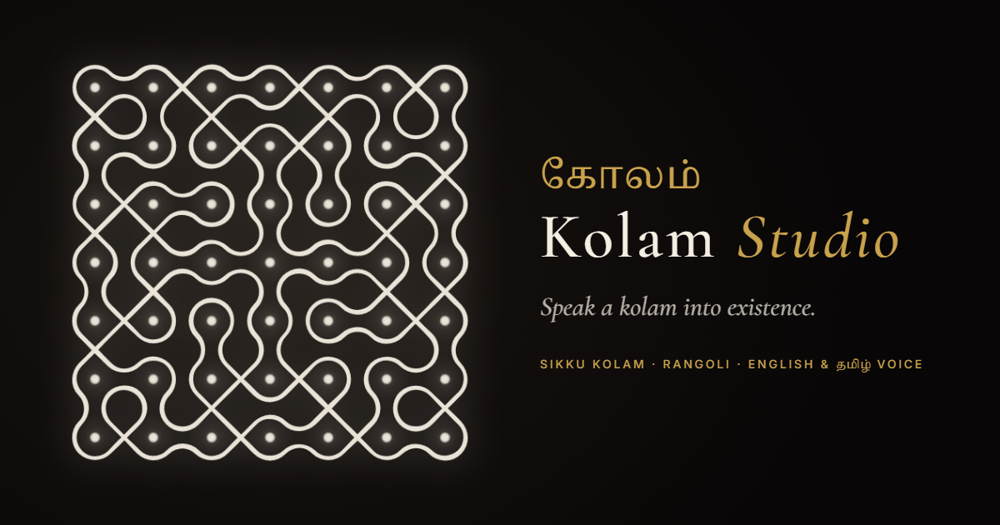
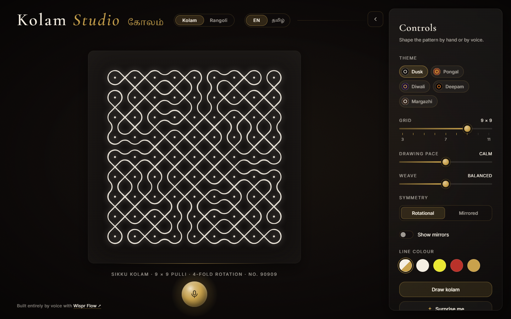
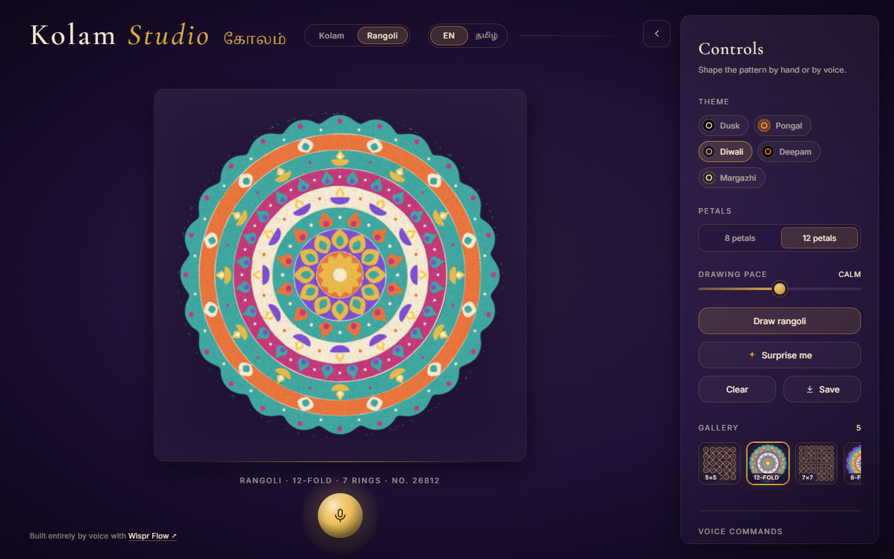
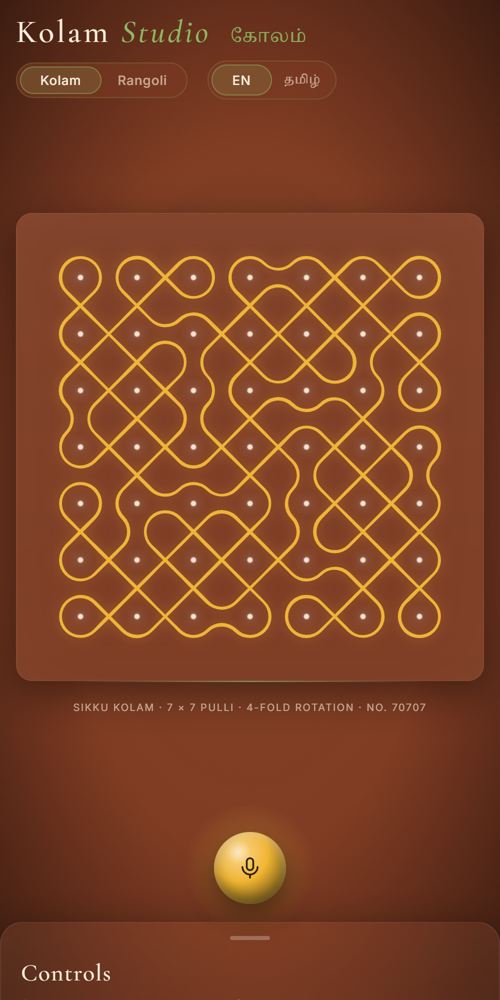
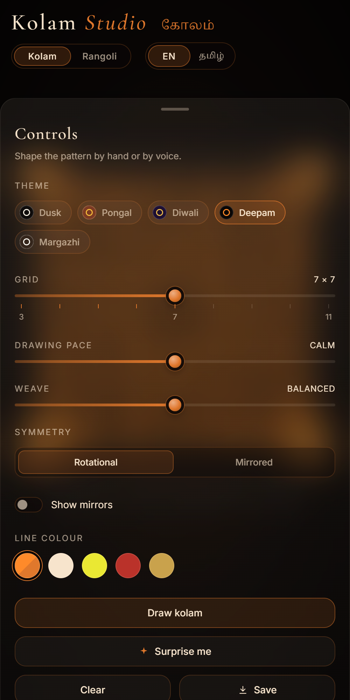

<div align="center">

# Kolam Studio · <span lang="ta">கோலம்</span>

**Speak a kolam into existence.**

A voice-controlled studio for South Indian *sikku kolam* and *rangoli*.<br>
Say it in English or Tamil and watch it drawn, line by line, like rice flour poured by hand.

### [▶ Open the live studio](https://adarshoff.github.io/kolam-studio/)



</div>

---

## The kolam

Every dawn across Tamil Nadu, doorsteps are swept, sprinkled with water, and decorated with a **kolam**: a design drawn freehand in rice flour around a grid of dots called *pulli*. The most intricate of them, the **sikku kolam** (<span lang="ta">சிக்கு கோலம்</span>, "tangled kolam"), is a single line that loops and weaves around every dot and returns to where it began, never lifting from the ground.

Kolam Studio draws these for you. Ask for one and it:

- **Generates an authentic sikku kolam**, always one continuous closed loop, with the 4-fold rotational symmetry of traditional designs.
- **Draws it as if by hand.** A brass lamp leads the line, rice-flour dust drifts behind it, the stroke swells and thins, and a shimmer crosses the finished design.
- **Switches to rangoli**, a fully filled, radially symmetric design in coloured powder. It is poured ring by ring from the centre: lotus petals, teardrops, dots and diyas.
- **Dresses for the festival** with five themes that crossfade in 800 ms: *Courtyard at Dusk*, *Pongal*, *Diwali* (with twinkling sparkles), *Karthigai Deepam* (with flickering diyas at the corners) and *Margazhi*.
- **Never repeats itself.** Every new design is checked against everything you've seen and everything in your gallery.
- **Keeps what you love.** Save exports a 3000 px PNG with a quiet watermark and adds the design to a gallery strip that redraws it exactly.

<table>
  <tr>
    <td></td>
    <td></td>
  </tr>
  <tr>
    <td align="center"><sub>Sikku kolam · 9 × 9 · Courtyard at Dusk</sub></td>
    <td align="center"><sub>Rangoli · 12-fold · Diwali</sub></td>
  </tr>
</table>

<p align="center">
  
  &nbsp;&nbsp;
  
</p>
<p align="center"><sub>On a phone the canvas spans the screen and the controls become a swipe-up sheet.</sub></p>

## The story of kolam and rangoli

A kolam is a greeting and an offering. It is drawn at the threshold before sunrise, usually by the women of the house. It welcomes guests and Lakshmi, and the rice flour feeds ants and birds: a small act of generosity at the start of each day. By evening the kolam has been walked over and blown away, and the next morning it is drawn again. Its beauty is meant to be temporary.

Skill is passed down by watching and repeating. A grandmother lays out the dots and a child learns to loop the line around them without lifting her hand. Designs grow more elaborate in **Margazhi** (mid-December to mid-January), when streets compete in great white kolams. At **Pongal**, the harvest festival, they bloom with colour, pots and sugarcane. At **Karthigai Deepam** they are ringed with lamps.

**Rangoli** is the sister tradition found across India: filled designs in coloured powder, flower petals or rice, made especially for **Diwali**. Where a kolam is a single disciplined line, a rangoli is colour poured into symmetry, usually radiating from a centre like a flower.

Both are mathematics drawn by people who might never call it that. The rules of a sikku kolam (go around every dot, never cross a dot, close the loop) are exactly the rules of a family of curves that mathematicians would study centuries later.

## Why it was built

Kolam is a living tradition, but it is learned at a doorstep, and fewer people now have a doorstep to learn it on. Kolam Studio is an attempt to keep the experience of watching one take shape: the patience, the single unbroken line, the moment it closes. It is meant to be shared with anyone curious, whether or not they grew up with it.

It is also a love letter to the idea that **voice can be a creative tool**. You don't need to know the rules or the vocabulary. Ask for "Pongal kolam" or "<span lang="ta">ரங்கோலி போடு</span>", in English or in Tamil, and the studio does the drawing while you watch. It should feel like talking to someone who knows how.

## Voice commands

Tap the brass orb or press <kbd>Space</kbd>, then speak. Matching is deliberately forgiving: "9x9", "nine by nine" and "grid nine" all work, and so do common mishearings ("new column", "Devoli theme", "rumbling mode"). Every phrase below is also a tappable pill in the panel, so you can try them without a microphone.

### English

| Say | What happens |
|---|---|
| `grid nine` · `nine by nine` · `9x9` | Sets a 9 × 9 grid and draws a new kolam (3 to 11) |
| `new kolam` · `draw` · `another` | A brand-new kolam |
| `colour red` · `make it gold` · `yellow` | Changes the line colour (rice flour, turmeric, kumkum, brass) |
| `clear` | Fades the design away |
| `rangoli mode` · `kolam mode` · `switch mode` | Switches between kolam and rangoli |
| `new rangoli` | A brand-new rangoli |
| `eight petals` · `twelve petals` | Sets the rangoli's symmetry and draws one |
| `Diwali theme` · `Pongal kolam` · `Margazhi` · `Karthigai Deepam` · `dusk` | Switches festival theme |
| `surprise me` | Shuffles to a random theme, size and design |
| `save` · `download` | Exports a high-resolution PNG and adds it to the gallery |
| `stop listening` | Turns the microphone off |

### Tamil · <span lang="ta">தமிழ்</span>

Switch the header from **EN** to **<span lang="ta">தமிழ்</span>**, and speech is recognised as Tamil (`ta-IN`).

| Say | Meaning | What happens |
|---|---|---|
| <span lang="ta">கோலம் போடு</span> · *kolam podu* | "draw a kolam" | A new kolam |
| <span lang="ta">ரங்கோலி போடு</span> · *rangoli podu* | "draw a rangoli" | A new rangoli |
| <span lang="ta">பொங்கல் கோலம்</span> · *Pongal kolam* | "Pongal kolam" | Pongal theme |
| <span lang="ta">தீபாவளி</span> · <span lang="ta">கார்த்திகை தீபம்</span> · <span lang="ta">மார்கழி</span> | the festivals | Switches theme |
| <span lang="ta">ஒன்பது கட்டம்</span> · *onbathu kattam* | "nine squares" | A 9 × 9 grid |
| <span lang="ta">எட்டு இதழ்</span> · *ettu ithazh* | "eight petals" | An 8-fold rangoli |
| <span lang="ta">அழி</span> · *azhi* | "erase" | Clears the design |
| <span lang="ta">சிவப்பு நிறம்</span> | "red colour" | Kumkum-red line |
| <span lang="ta">ஆச்சரியம்</span> | "surprise" | Surprise me |
| <span lang="ta">சேமி</span> | "save" | Saves the design |

Tamil words work with their suffixes (<span lang="ta">கோலத்தை</span>, <span lang="ta">அழித்துவிடு</span>…). They also work in English mode, where the recogniser hears *kolam podu* as "column board" and *azhi* as "R".

## How mirror curves make a kolam

In the 1980s and 1990s the mathematician **Paulus Gerdes** studied the *sona* sand drawings of the Chokwe people of Angola, and the closely related kolams of South India. He noticed that the drawings could be generated by imagining **mirrors** placed between the dots, an idea he called *mirror curves*.

Picture a grid of dots. Halfway between every pair of neighbouring dots there is a small slot. A ray of light travels diagonally from slot to slot, never passing over a dot. At each slot one of three things happens:

```
   crossing           horizontal mirror      vertical mirror
      ╲ ╱                  ╲   ╱                ╲  │  ╱
       ╳                    ───                  ╲ │ ╱
      ╱ ╲                  ╱   ╲                  ╱│╲
  passes straight        bounces up/down       bounces left/right
```

The frame around the grid is lined with mirrors, so the ray always reflects back inward. Follow it and it must eventually return to where it started: a closed loop. Smooth its corners and it becomes a kolam. **Crossings** give the woven sikku look; **mirrors** give the loops that wrap around dots.

The catch is that a random arrangement of mirrors usually produces *several* separate loops. A true sikku kolam is *one* line, so the generator has to search for arrangements that close into a single loop.

## How the generators work

### Kolam

1. **A doubled grid.** Dots sit at odd coordinates `(2i+1, 2j+1)`, and slots sit where `x + y` is odd. The line steps diagonally, `(x, y) → (x ± 1, y ± 1)`, so it can never land on a dot.
2. **Symmetry first.** Slots are grouped into *orbits* under the chosen symmetry. Each orbit gets one random state: crossing, horizontal mirror or vertical mirror, weighted by the *Weave* slider. A 90° turn swaps horizontal and vertical mirrors, so states are swapped as they're copied around.
3. **Count the loops.** Tracing from every unvisited segment counts the loops. Every diagonal segment belongs to exactly one loop, so a single loop is guaranteed to pass around every dot.
4. **Search, then repair.** Random arrangements are tried until one gives a single loop. If that's slow, the best attempt is hill-climbed, changing one orbit at a time and keeping changes that don't add loops.
5. **Respect what's possible.** Testing turned up two hard limits. Any diagonal reflection (and so 8-fold symmetry) *never* gives a single loop. On even grids, any 180° symmetry always leaves an *even* number of loops. So odd grids use 4-fold rotation, and even grids fall back to a left-right mirror. The generator knows this and doesn't waste time.
6. **Draw it like a hand would.** Each step becomes a cubic Bézier between segment midpoints: straight through crossings, and a true quarter circle at mirrors, centred on the dot it wraps. The stroke is filled as a ribbon whose width follows a few slow waves, periodic over the loop so the end meets the start without a seam.

### Rangoli

1. **Design as data.** A seed and a symmetry (8 or 12) produce a centre flower and 5 to 7 rings: lotus petals, teardrops, dots, diyas, and sometimes a scalloped outer border. Each ring uses three palette slots, and neighbouring bands never share a colour. Every rangoli includes a ring of diyas.
2. **Powder, not vector art.** Each ring is painted to its own canvas. Outlines are nudged in and out by smoothed noise so edges wobble like poured powder, softened with a blur of their own colour, and dusted with thousands of light and dark grains. A few stray grains land just past the edge.
3. **Poured ring by ring.** On screen, each ring is revealed by a sweep clockwise from the top, from the centre outward. Dust in the ring's colour drifts from the pouring point.
4. **Themes recolour, they don't redraw.** The design stores palette *slots*, not colours, so a new theme crossfades the same rangoli into new colours.

### Never repeating

A design's identity is its **fingerprint**: a hash of the kolam's actual mirror layout (so two seeds that happen to produce the same kolam still count as a repeat), or the rangoli's seed and symmetry. New designs keep drawing seeds until the fingerprint is new to this session *and* absent from the gallery.

## Built by voice

**This entire project was built by voice, using [Wispr Flow](https://wisprflow.ai) and [Claude](https://claude.ai).** Every feature, from the mirror-curve generator and the powder texture to the Tamil commands and this README, began as something spoken aloud. Wispr Flow turned speech into prompts, and Claude turned prompts into code. No keyboard was needed to describe what a kolam should feel like.

It seemed right. A kolam is made with the hands and no instruments; this one was made with the voice and no keyboard.

## Run it locally

It's a single `index.html` with vanilla JavaScript and HTML Canvas. There's no framework and no build step.

```bash
git clone https://github.com/adarshoff/kolam-studio.git
cd kolam-studio
npx serve .        # or: python -m http.server
```

Open the address it prints. A local server (or HTTPS) is needed for the microphone, and it lets the browser remember mic permission.

- **Voice** uses the Web Speech API, so it needs **Chrome or Edge** and an internet connection. Everything else works in any modern browser, and every voice command is also a button or a tappable pill.
- **Accessibility:** `prefers-reduced-motion` is honoured throughout. Designs appear complete, without animated lines, dust, ripples or glides.
- **Replay the intro** by adding `?intro` to the URL.

```
index.html             the whole app: markup, styles, generators, renderer, voice
og-image.png           link-preview image
apple-touch-icon.png   home-screen icon
docs/                  screenshots for this README
CLAUDE.md              notes for working on the code
```

## License

[MIT](LICENSE) © 2026 ADARSH V
